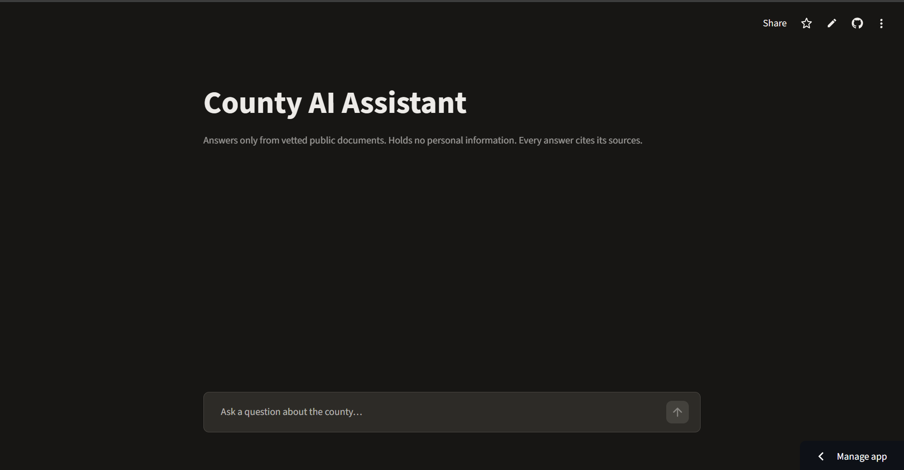

# County AI Assistant

> A RAG chatbot that answers questions strictly from vetted public documents — and cites every source.

## Overview

County AI Assistant is a retrieval-augmented generation (RAG) assistant that answers questions using only a curated set of vetted documents. Every answer cites the source files it drew from, and when the answer isn't in the documents, the assistant says so instead of guessing. This keeps responses grounded, auditable, and safe to put in front of the public.

## Demo

**Live app:** (https://county-ai-assistant.streamlit.app/)

> 

## Features

- **Grounded answers** — responses come only from the provided documents, never the model's open-world knowledge.
- **Inline source citations** — each answer cites the filenames it used, e.g. `[owen_county_economy.md]`.
- **Explicit refusal** — replies `"I don't have that in the provided documents."` when the context doesn't cover the question.
- **PII scrubbing at ingest** — emails and phone numbers are redacted before anything is indexed.
- **Simple chat UI** — a lightweight Streamlit conversation with per-answer source expanders.

## How it works

The pipeline is split into two stages: an offline **ingest** step that builds a search index, and an online **query** step that answers questions against it.

```
INGEST (python ingest.py)
  docs/*.md,*.txt ──► chunk (~800 chars, 150 overlap) ──► scrub PII (regex)
       ──► embed (all-MiniLM-L6-v2) ──► save index/ (embeddings.npy + chunks.json)

QUERY (streamlit run app.py)
  question ──► embed ──► cosine top-k over index ──► Claude answers
       from retrieved context ──► answer + [source] citations
```

Ingest is a one-time (regenerable) build; the query path loads that index once and reuses it for every question. The index is a git-ignored build artifact — regenerate it from `docs/` any time with `python ingest.py`.

## Tech stack

- **Generation:** Claude via the Anthropic Messages API
- **Embeddings:** `sentence-transformers` (`all-MiniLM-L6-v2`)
- **Retrieval:** in-memory NumPy cosine similarity (normalized dot product)
- **UI:** Streamlit
- **Language:** Python

## Project structure

```
county-ai-assistant/
├── ingest.py          # Build the search index from docs/ (chunk → scrub PII → embed → save)
├── rag.py             # Retrieval + answer core: cosine top-k, then Claude grounded in context
├── app.py             # Streamlit chat UI over rag.py
├── docs/              # Vetted source documents (.md / .txt) — the only knowledge base
├── requirements.txt   # Python dependencies
├── .env               # ANTHROPIC_API_KEY (not committed)
└── index/             # Generated embeddings + chunks (git-ignored, regenerable)
```

## Getting started

### Prerequisites

- Python 3.12
- An Anthropic API key

### Setup

1. **Clone the repository**
   ```bash
   git clone <your-repo-url>
   cd county-ai-assistant
   ```

2. **Create and activate a virtual environment**
   ```bash
   python -m venv .venv
   # Windows
   .venv\Scripts\activate
   # macOS / Linux
   source .venv/bin/activate
   ```

3. **Install dependencies**
   ```bash
   pip install -r requirements.txt
   ```

4. **Add your API key** — create a `.env` file in the project root:
   ```
   ANTHROPIC_API_KEY=your-key-here
   ```

5. **Build the index** from the documents in `docs/`
   ```bash
   python ingest.py
   ```

6. **Run the app**
   ```bash
   streamlit run app.py
   ```

## Usage

Ask a question in the chat box. For example:

> **Q:** Could the public library serve as the county's AI access point?
>
> **A:** …a grounded answer drawn from the vetted documents, ending with the sources it used, e.g. `[sample_ai_readiness_note.md]`.

If the documents don't contain the answer, the assistant replies: _"I don't have that in the provided documents."_

## Privacy & guardrails

- **Retrieval-only grounding** — the model answers from retrieved passages, not open-world knowledge.
- **Mandatory citations** — every answer names the source files it used.
- **PII scrubbing** — a regex pass redacts emails and phone numbers at ingest time, before indexing.
- **Secrets stay out of the repo** — the API key is read from an environment variable / `.env` (or a deployment secret) and is never committed.
- **Index not committed** — the generated `index/` is git-ignored and rebuilt from `docs/`.

## Limitations & future work

- **Regex PII scrubbing is best-effort** — it catches common email and phone formats, not every variant; review sensitive source documents before indexing.
- **In-memory retrieval** — the NumPy index loads fully into memory, which is fine for a small vetted corpus. To scale, swap in a vector database such as Chroma or FAISS.
- **No auth or rate limiting** — add authentication and request throttling before a production or public deployment.

## License

[MIT](LICENSE)
